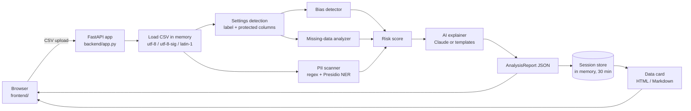

# Dataset Bias & Privacy Auditor

> Screen a dataset for bias, missing data and personal data **before** it is used to train a model.

- **Live demo:** TODO: add the Render URL after deploying (see [Deployment](#deployment))
- **Demo video:** TODO: add the video link
- **Hackathon:** NYLP AI Hackathon 2026

---

## Problem

People who are already under-represented or treated unfairly (women, minorities, older applicants,
anyone whose personal data is collected) are the ones hurt when a model learns from a skewed,
incomplete or privacy-leaking dataset. Those problems are cheapest to fix before training, but
small teams rarely have the time or expertise to check for them.

## Solution

Upload a CSV and the auditor runs a set of statistical and pattern-based checks in memory, then
explains every issue in plain language and produces a downloadable **data card** (a datasheet
for the dataset). It answers three questions:

1. **Bias:** Are outcomes unbalanced? Do some groups get the positive outcome far less often?
   Do other columns act as hidden stand-ins (proxies) for protected attributes?
2. **Missing data:** Which columns and rows have gaps, and are gaps concentrated in particular
   groups?
3. **Privacy:** Does the data contain emails, phone numbers, ID numbers, card numbers,
   addresses, IP addresses, names or dates of birth?

## Features

- Drag-and-drop CSV upload (up to 10 MB, 50,000 rows and 100 columns) and two bundled synthetic
  samples.
- Auto-detection of the label column and protected attributes from column names, with a
  settings panel to correct them and re-run the analysis on the same in-memory data.
- Bias checks: class imbalance, four-fifths (80%) rule for outcome rates per group (numeric
  attributes such as age are binned), proxy detection with Pearson r, Cramer's V or eta.
- Missing-data checks: per column, per row, chi-squared test plus rate ratio across groups, and
  co-occurring gaps (reported as a pattern worth investigating, not as a proven cause).
- PII scan: regex and heuristic rules (including Pakistani CNIC and mobile number formats) plus
  optional Microsoft Presidio NER.
- 0-100 risk score with a level (Low / Medium / High / Critical).
- Plain-language explanation and recommendation for every finding, an overall summary and the
  top 3 priority actions, written by Claude when an API key is set and by built-in templates
  otherwise. The badge on the dashboard always says which one you are seeing.
- Charts (class distribution, outcome rate per group with the 80% line, missing share per
  column), each with a table view.
- Data card download as self-contained HTML (print-friendly, colour-coded severity badges) or
  Markdown.
- Light and dark themes, keyboard-accessible tabs, works on a 375 px wide phone screen.

## Tech Stack

| Layer | Technology |
|---|---|
| Backend | Python 3.11+ (developed on 3.12), FastAPI, Uvicorn |
| Analysis | pandas, NumPy, SciPy, Pydantic |
| PII detection | Regex rules, Microsoft Presidio Analyzer with spaCy `en_core_web_sm` |
| AI explanations | Anthropic Python SDK (Claude API), optional |
| Frontend | Vanilla HTML, CSS and JavaScript, Chart.js 4 from a CDN; no build step |
| Tests | pytest, HTTPX, FastAPI TestClient |
| Deployment | Render Blueprint (`render.yaml`), native Python 3.12 runtime, free plan |

## AI / API Usage

The app uses two AI components. Neither is needed for the core analysis: all statistics, scores
and detections are computed locally by plain Python code.

### 1. Microsoft Presidio + spaCy `en_core_web_sm` (PII detection, runs locally)

- **What it does:** named-entity recognition that finds person names, emails, phone numbers,
  SSNs, card numbers and IP addresses inside free-text columns that the regex rules may miss
  (for example "Spoke with John Smith about the refund").
- **What data it receives:** up to 200 distinct non-empty values per text column. It runs inside
  the server process; nothing is sent over the network.
- **Safeguards:** a column is flagged only when at least 5% (and at least 2) of the sampled
  values contain an entity, and person matches containing digits are ignored, because the small
  model tags ID codes such as `R0168` as names. Counts from NER-only columns are reported as a
  lower bound.
- **If unavailable:** if Presidio or the model is not installed or fails to load, or
  `PII_NER_ENABLED=false`, the scanner logs a warning and uses the regex rules only. The PII tab,
  `/api/health` and the data card all state which detectors ran.

### 2. Anthropic Claude API (plain-language explanations, optional)

- **Model:** `claude-opus-5-5` by default; override with `LLM_MODEL`. Key from
  `ANTHROPIC_API_KEY`. Both are read from environment variables only.
- **What it does:** turns each finding into a 2-3 sentence explanation of why it matters for
  responsible AI plus one concrete recommendation, and writes a 3-4 sentence overall summary and
  the top 3 priority actions.
- **What data it receives (and what it never receives):** for each finding only an id, the
  category, severity, title, column names and aggregate numbers (shares, ratios, counts,
  p-values, statistic names), plus the dataset's row count, column count and risk score.
  **It never receives cell values, rows, group labels, label values or the finding
  descriptions** (which can name groups). `backend/ai/explainer.py::finding_metrics` builds this
  payload, and `tests/test_explainer.py` checks that no raw value from a fake-PII DataFrame
  appears in the outgoing request.
- **Workflow:** all findings are sent in **one** Messages API request with a JSON schema
  (structured output). The reply is validated with Pydantic; invalid output is retried once.
  The system prompt and user prompt template are in one constants block at the top of
  `backend/ai/explainer.py`.
- **Template fallback:** with no key, an API error, a timeout (15 s by default,
  `LLM_TIMEOUT_SECONDS`), a refusal, or invalid output twice, every finding gets a built-in
  template explanation written for its finding type. The report then has `ai_enabled: false`,
  each finding has `explanation_source: "template"`, and the dashboard shows a
  "Template explanations" badge. **The app is fully usable without a key.**
- **Cost control:** one request per analysis, `effort: low` by default (`LLM_EFFORT`), and a
  per-IP rate limit of 30 requests per minute on the API.

## Architecture



**Pipeline** (`backend/orchestrator.py`):

1. **Upload.** The request body is capped at 10 MB plus form overhead *before* it is parsed, and
   Starlette's multipart spool limit is raised above that cap, so an upload is never rolled over
   into a temporary file on disk (`tests/test_api.py::test_upload_stays_in_memory` checks this).
   Files must end in `.csv` and must not look binary.
2. **Load.** Bytes are decoded as UTF-8, UTF-8 with BOM, then Latin-1 and parsed with pandas.
   Empty files, header-only files, malformed CSV, files over 10 MB, over 50,000 rows or over 100
   columns are rejected with a clear message. The column count is read from the header before the
   full parse: some checks compare every pair of columns, so time grows with the square of the
   column count (1,600 columns took over four minutes on a desktop PC). Duplicate column names
   are renamed `name.1`, `name.2`. Besides pandas' defaults (empty, NA, N/A, NULL, nan, None),
   whole-cell placeholders `?`, `-`, `--`, `unknown`, `missing`, `na`, `n.a.`, `nil` and
   `undefined` are read as missing, and the space after each comma is skipped, so UCI-style
   `, ?` gaps are counted. `none` is kept, because it is often a real answer.
3. **Settings detection** (`bias_detector.detect_settings`). Protected attributes are columns whose
   name contains a word such as gender, sex, sexual (orientation), race, ethnicity, age,
   religion/religious, disability, nationality, citizenship, marital, caste or pregnancy, or a
   phrase such as national_origin or native_country (matched as whole words, so `page_views` and
   `wage` are not "age", and `national_id` is not "national origin"). The label is a column named
   label/target/class/outcome/y/hired/approved/default; then a common label name such as survived,
   churn, exited, is_fraud, two_year_recid or loan_status if that column has 2-10 distinct
   values; otherwise the last column if it has 2-10 distinct values. The user can override both
   and re-run.
4. **Analyzers** (`backend/analyzers/`), described below.
5. **Risk score** from the findings' severities.
6. **AI explanation layer**, described above.
7. **Report and data card.** The report holds findings, counts, chart data and the AI summary.
   The DataFrame stays in the session store for re-analysis and data cards and is never
   serialized into the report.

### What each detector does

| Check | How | Severity |
|---|---|---|
| Class imbalance | Label class shares; flagged if a class is under 10% or largest:smallest > 3:1 | critical > 10:1, high > 5:1, medium > 3:1 |
| Demographic disparity | Favourable-outcome rate per protected group vs. the best group (four-fifths rule). Which value is favourable: when the label is 1/0, yes/no or true/false and its name marks a bad event (default, fraud, churn, exited, recidivism, readmitted...), the 0/no value; otherwise a value that looks positive (1/yes/true/hired/approved/good/fully paid...); otherwise, with two values where one looks negative (rejected, bad, charged off), the other one; otherwise the least frequent value. Numeric attributes are binned (age: under 30, 30-50, over 50; others: tertiles). Groups under 20 rows are skipped and named in the finding. A group below 80% counts as a gap only if it differs from the best group significantly (Fisher's exact test, p < 0.05), following the EEOC note that small-number differences may be chance; other groups below 80% are listed as "possibly chance", and when no gap is significant the finding is low severity. | critical if a significant group's ratio < 0.6, high < 0.8, low when no gap is significant |
| Proxy correlation | Every non-protected, non-ID feature vs. each protected attribute: Pearson r (numeric-numeric), bias-corrected Cramer's V (categorical-categorical), correlation ratio eta (numeric-categorical). ZIP/ID/code columns are treated as categories. | high > 0.7, medium > 0.5 |
| Column missingness | Share of empty cells (NaN, empty or whitespace-only strings, and placeholders such as `?`, `-` or `unknown`; see Load above) | critical > 50% or fully empty (drop), high > 20%, medium > 5% |
| Row missingness | Rows with any gap, rows missing more than half their columns | flagged above 10% of rows |
| Missingness by group | Chi-squared test (p < 0.01) **and** rate ratio between the groups with the highest and lowest missing rate | critical > 2x, high > 1.5x |
| Co-occurring gaps | Phi coefficient between the missing-indicators of two columns (at least 5 shared rows) | medium > 0.8, low > 0.5 |
| PII: SSN-style IDs, Pakistani CNICs, card numbers | Regex (`XXX-XX-XXXX` and spaced form; CNIC `12345-1234567-1`, or 13 digits in a column named cnic/nic); 13-19 digit candidates checked with the Luhn algorithm, with CNICs excluded so they are not reported as cards | critical |
| PII: emails, phones | Regex. Phones need 8-15 digits and separators, brackets or a leading + (North American, international with or without spaces) or the Pakistani mobile prefix (`0300-1234567`, `03001234567`); plain 7-15 digit values also count in columns named like phone/mobile/contact. Presidio phone hits need 9+ digits, a separator, bracket or +, and no overlap with a CNIC or SSN | high |
| PII: names, addresses, IPs, dates of birth | Name/DOB/address column-name rules, street-address regex, IPv4 (valid octets) and full IPv6 regex (not in columns named version/build/release/firmware), Presidio NER | medium |

### Risk score

Each finding adds points by severity, with a cap per severity: critical 25 each (max 60),
high 10 each (max 30), medium 3 each (max 15), low 1 each (max 5). The total is capped at 100.
Level: **Critical** above 75, **High** above 50, **Medium** above 25, otherwise **Low**.

### Sessions

Each analysis is stored in memory under a random `uuid4` session id together with its DataFrame,
settings and report (`backend/session_store.py`). Sessions expire 30 minutes after last use and
at most `MAX_SESSIONS` are kept (default 50; the least recently used is dropped). There is no
global "latest result": every request names its session, and the browser keeps the id only in
page memory, so two tabs never see each other's results. Restarting the server clears
everything.

### API

| Method | Path | Purpose |
|---|---|---|
| GET | `/` | Dashboard (static files from `frontend/`) |
| POST | `/api/upload` | Multipart `file`, optional `label_column` and `protected_columns` (JSON list or comma-separated) |
| POST | `/api/reanalyze/{session_id}` | JSON `{"label_column": ..., "protected_columns": [...]}`; re-runs on the stored data |
| GET | `/api/download/{session_id}/datacard/{html\|md}` | Data card download |
| GET | `/api/sample-datasets` | Bundled samples |
| POST | `/api/analyze-sample/{name}` | Analyze a bundled sample (exact-name lookup, no paths) |
| GET | `/api/health` | Status, whether AI is enabled, which PII detectors are active (never the key) |

Errors are JSON `{"detail": "..."}` with 400 (malformed/empty CSV, unknown column), 404 (unknown or
expired session), 413 (over 10 MB, 50,000 rows or 100 columns), 415 (not a CSV), 422 (invalid settings body) or
429 (rate limit, with `Retry-After`). Request bodies are never logged; unexpected errors are logged
by exception type only, because exception messages can echo cell values.

## Setup Instructions

Requirements: Python 3.11 or newer and Git.

```bash
git clone <repository-url>
cd dataset_auditor
python -m venv venv
```

Activate the virtual environment (`venv\Scripts\activate` on Windows,
`source venv/bin/activate` on macOS/Linux), then:

```bash
pip install -r requirements.txt
```

This also installs the spaCy model `en_core_web_sm` from its official GitHub release.

Optional: enable AI explanations.

```bash
cp .env.example .env
```

(On Windows Command Prompt use `copy .env.example .env`.) Then put your key in `.env` as
`ANTHROPIC_API_KEY=...`. `.env` is git-ignored. **The app works without a key**; it
then uses the built-in template explanations.

Run the app and open http://localhost:8000:

```bash
python backend/app.py
```

### Configuration

| Variable | Default | Meaning |
|---|---|---|
| `PORT` | `8000` | Port the server listens on (host is `0.0.0.0`) |
| `ANTHROPIC_API_KEY` | empty | Enables AI explanations when set |
| `LLM_MODEL` | `claude-opus-5-5` | Claude model for explanations |
| `LLM_TIMEOUT_SECONDS` | `15` | Timeout for the explanation request, then templates are used |
| `LLM_EFFORT` | `low` | Effort level sent to the model (empty to omit) |
| `PII_NER_ENABLED` | `true` | `false` skips Presidio/spaCy (saves memory; regex rules still run) |
| `RATE_LIMIT_PER_MINUTE` | `30` | Requests per minute per client IP on `/api/*` (health excluded) |
| `MAX_SESSIONS` | `50` | Analyses kept in memory at once; lower it on small hosts (`render.yaml` sets 10) |
| `FORWARDED_ALLOW_IPS` | `127.0.0.1` | Proxies whose `X-Forwarded-For` is trusted (set `*` behind a host's proxy) |
| `DEV_CORS` / `CORS_ORIGINS` | `false` | Development only: allow a separately served frontend |

### Tests

```bash
python -m pytest
```

The suite has unit tests per analyzer, the explainer (mocked API client), the data card, every API
endpoint, the sample datasets, the Render Blueprint (`tests/test_deploy_config.py`), and an
end-to-end test (`tests/test_e2e.py`) that starts the real server on a free port and uses it
over HTTP. Tests never call the real Claude API. Manual checks are recorded in
`tests/MANUAL_TEST_LOG.md`.

### Sample data

`sample_data/generate_samples.py` regenerates both CSVs deterministically (fixed seed). **All
sample data is synthetic and not about real people**: emails use `example.com`, phones use the
fictional 555-01xx range and SSN-style IDs start with 000, 666 or 9xx, which are never issued.

- `problematic_hiring.csv` (500 rows): planted gender, race and age outcome gaps, a ZIP-code proxy
  for race, about 22% positive labels, income missing mostly for women, and fake identifiers.
  The original brief asked for "about 40% vs 70%" hiring rates *and* "about 25% hired overall",
  which cannot both be true, so the generator keeps the 40:70 ratio (women hired at about 55% of
  the men's rate) and the low overall rate.
- `clean_survey.csv` (300 rows): no PII, no protected attributes, balanced classes, under 2%
  missing. It produces no findings.

### Accuracy check on real data

The synthetic samples are built to trigger the detectors, so on 18 Oct 2026 the auditor was also
run on two public datasets, downloaded for this test only (they are **not** in this repository):
[UCI Adult](https://archive.ics.uci.edu/dataset/2/adult) (32,561 rows; the raw file has no
header, so one was added) and ProPublica's
[COMPAS two-year recidivism file](https://github.com/propublica/compas-analysis) (7,214 rows,
which holds real defendants' names and birth dates). For each, the expected numbers were
computed separately with plain pandas, without the app's code, and compared with the app's
output:

| Check | Plain pandas | Auditor |
|---|---|---|
| Adult: earning >50K, women vs men (rate ratio) | 0.358 (10.9% vs 30.6%) | 0.36, critical |
| Adult: lowest race ratio / under-30 ratio | 0.347 / 0.158 | 0.35 / 0.16, critical |
| Adult: missing `workclass` / `occupation` (`?` cells) | 5.6% / 5.7% | 5.6% / 5.7% |
| Adult: strongest proxy | `relationship` vs `sex`, Cramer's V 0.65 | same, 0.65 |
| Adult: personal data | none | none |
| COMPAS: label | `two_year_recid` (last column) | `two_year_recid` |
| COMPAS: not re-offending, race (African-American vs best group) | ratio 0.676 | 0.676, high |
| COMPAS: not re-offending, `age_cat` | 0.790 and 0.636 | 0.79 and 0.64, high |
| COMPAS: not re-offending, sex | 0.819 (above 0.8) | not flagged |
| COMPAS: `violent_recid`, `c_arrest_date` | 100% / 84.2% missing | completely empty / 84.2% |
| COMPAS: proxies of `age` | `decile_score` 0.50 and 0.50, `v_decile_score` 0.67 | same three |
| COMPAS: personal data | `name`, `first`, `last`, `dob` | the same four, plus one false positive |

The check found four real problems, all fixed: with both `is_recid` and `two_year_recid` present
the app picked the wrong label (it now prefers the last matching column), which flagged a sex gap
that is not there; groups with a few dozen rows were flagged as gaps when the best group was
tiny (9 of 25 flagged `native-country` groups on Adult were not statistically significant, hence
the significance test described above); the small spaCy model tagged charge descriptions such as
"Disorderly Conduct" as person names (three columns); and columns named just `first` and `last`
were found only by NER, in 207 and 92 rows instead of all 7,214.

Still open: one charge-description column (`vr_charge_desc`) is still reported as person names.
The auditor also gives COMPAS a risk score of 100/100 and about 60 "gaps occur together"
findings, which are true but repetitive. Finally, the COMPAS rows above are about *outcome
rates in the data*; they say nothing about the error rates of the COMPAS risk score, which is
what ProPublica's well-known analysis examined, and the auditor does not evaluate model
predictions. The expected numbers use the same definitions as the code (ratio to the best group,
uncorrected Cramer's V), so this checks the implementation, not whether those definitions are
the only valid ones. Raw results are in `tests/MANUAL_TEST_LOG.md`.

## Deployment

The repository is set up for a **free Render web service** on Render's native Python runtime.
The Blueprint file [`render.yaml`](render.yaml) describes it, and no Docker image is needed.

### Why Render

Free-tier terms checked on 17 Oct 2026 in Render's and Hugging Face's documentation:

| | Render free web service | Hugging Face Spaces (Docker SDK) |
|---|---|---|
| Price | Free; 750 instance hours per workspace per month | CPU Basic hardware has no hourly cost, but creating a Docker Space needs a paid PRO plan on a personal account |
| Resources | 512 MB RAM, 0.1 CPU | 2 vCPU, 16 GB RAM |
| When idle | Spins down after 15 minutes without traffic; the next visit waits about a minute | Goes to sleep after an unspecified period without use |
| Setup | Connect the GitHub repository; Render reads `render.yaml` | Push to a Space repository with a Dockerfile and `sdk: docker` |

Render was chosen because it needs no paid plan, deploys straight from the GitHub repository,
and runs the same `python backend/app.py` command used locally. Hugging Face would give far
more memory, but its Docker Spaces now require PRO.

### Memory and the Presidio NER layer

Presidio + spaCy stay **on** (`PII_NER_ENABLED=true`). Measured locally on Windows 11 with
Python 3.12 (working set of the server process, no API key):

| Configuration | After startup | Peak |
|---|---|---|
| NER on | 228 MB | 245 MB with both samples; 325 MB with four uploads of a 5.6 MB, 49,000-row CSV |
| NER off (`PII_NER_ENABLED=false`) | 141 MB | 144 MB with both samples |

That fits under the 512 MB limit. These are Windows numbers, not measurements from Render's
Linux containers, so check the service's **Metrics** page after the first deploy. If the
service runs out of memory or is too slow on 0.1 CPU, set `PII_NER_ENABLED=false` in the
Render dashboard. The trade-off: the regex and column-name rules still run, and on both
bundled samples they give exactly the same findings, but names and other entities inside
free-text columns (such as "Spoke with John Smith") are no longer found. The PII tab,
`/api/health` and the data card show which detectors ran.

Sessions also use memory: each one keeps its DataFrame for 30 minutes. A 5.6 MB test file kept
about 12 MB; a dense 8.6 MB, 50,000-row file of short text kept about 27 MB and peaked at 439 MB
while it was analysed. With the default of 50 sessions, large uploads in a short time could
exhaust 512 MB, so `render.yaml` sets `MAX_SESSIONS=10`. A restart clears all sessions.

### What `render.yaml` sets

- **Build:** `pip install -r requirements.txt`, which also downloads the spaCy model
  `en_core_web_sm` 3.8.0 from its GitHub release.
- **Start:** `python backend/app.py`. Render provides `PORT`, and the app listens on
  `0.0.0.0:$PORT`.
- **Python 3.12**, pinned in [`.python-version`](.python-version) (Render's default for new
  services is a newer version).
- **Health check:** `/api/health`.
- **`MAX_SESSIONS=10`:** at most 10 analyses are kept in memory, instead of the default 50.
- **`FORWARDED_ALLOW_IPS=*`:** Render's proxy sits in front of the app, so uvicorn takes the
  client address from `X-Forwarded-For`. Without this, every visitor would be counted under the
  proxy's own address and share its rate limit. With `*`, uvicorn uses the first address in that
  header, which a client can set itself, so the per-IP rate limit is best effort on the live
  site.
- **`ANTHROPIC_API_KEY` and `LLM_MODEL`** are marked `sync: false`: Render asks for them in its
  dashboard when the Blueprint is created, and they are never stored in the repository. Both
  are optional. With no key the live site uses template explanations; an empty `LLM_MODEL`
  means `claude-opus-5-5`. If you do add a key, set a monthly spend limit for it in the Anthropic
  Console: anyone with the live URL can trigger analyses, and the rate limit can be bypassed.

### Deploy steps

1. Push this repository to GitHub.
2. In the Render dashboard choose **New > Blueprint**, find the repository and click
   **Connect**. Name the Blueprint and pick the `main` branch.
3. Enter `ANTHROPIC_API_KEY` and `LLM_MODEL` when asked (or leave them empty), then click
   **Deploy Blueprint**.
4. When the build finishes and the health check passes, open the `onrender.com` URL that Render
   shows for the `dataset-auditor` service.

Every push to `main` then redeploys automatically. Render may restart free services at any
time, which clears the in-memory sessions, and Render's own docs advise against using free
instances in production.

## Screenshots

TODO: add screenshots of the upload page, results dashboard, each tab and a data card
(`docs/screenshots/`).

## Team Contributions

> **TODO: real names and roles.** This section must list the actual team members and what each
> person did. It is intentionally left blank rather than filled with invented names.

## Limitations

- **A screening aid, not a compliance guarantee.** A clean report does not mean a dataset is fair,
  representative or lawful to use, and a finding is a prompt to investigate, not a verdict.
- **Protected attributes are found by column name.** Columns with unusual names, other languages
  or coded values (`col_7`, `g`) are missed unless set manually in the settings panel. Attributes
  that are not in the data at all cannot be checked.
- **False positives:** ID-like numbers can match phone or card patterns; NER can tag ordinary
  words as names (on COMPAS it reported a column of charge descriptions such as "Battery" as
  person names; it needs a quarter of the sampled values to look like names in columns where
  values repeat a lot, but that does not catch every case); proxy checks flag legitimate correlations (experience rises with age); a name
  such as `sex_offender_flag` is read as a protected attribute because it contains "sex".
- **The favourable outcome is a guess.** It follows the rules in the table below and the finding
  says which value was used (rules in "What each detector does" above), but it can be wrong for
  unusual labels, and the settings panel
  cannot change it.
- **False negatives:** PII in unusual formats, national IDs other than US SSNs and Pakistani
  CNICs, other languages, or rare values outside the NER sample of 200 can be missed. Phone
  numbers stored as plain digits are only found in columns named like phone/mobile/contact. ZIP codes and other quasi-identifiers are
  not flagged as PII on their own. Combinations of features that together reveal a protected
  attribute are not detected (proxies are checked one feature at a time).
- **Statistics need enough rows.** Groups under 20 rows are skipped, chi-squared tests are weak on
  small data, and Cramer's V / eta can be inflated by many categories. A gap below 80% that is
  not statistically significant is reported as low severity ("could be chance"), so with few rows
  a real disparity can show up only as a low-severity note. The best group is the one with the
  highest rate even if it is small, which is how the four-fifths rule is written; the
  significance test is what guards against a tiny best group.
- **Not covered:** label quality, measurement bias, sampling bias against the real population,
  consent and data provenance, and intersectional groups (for example older women).
- **Limits:** 10 MB / 50,000 rows / 100 columns per file; comma-separated files only; sessions live in one
  server process's memory and are lost on restart.
- **AI explanations** are generated text: they are based only on the aggregate numbers they are
  given and can still be imprecise. The numbers in the finding description are the source of truth.

## Third-Party Libraries

See [THIRD_PARTY.md](THIRD_PARTY.md) for every library with its version and license. All are
permissively licensed (MIT, BSD-3-Clause or Apache-2.0).

## Acknowledgments

- Built fresh for the NYLP AI Hackathon 2026.
- Data card structure inspired by Google's *Data Cards* and Gebru et al.'s *Datasheets for
  Datasets*; the four-fifths rule follows the US EEOC Uniform Guidelines.
- Microsoft Presidio and spaCy for PII detection, Chart.js for charts.
- **AI tools used during development:** Claude Code was used as a development assistant to write
  and test code and documentation. All code was reviewed and tested by the team.
